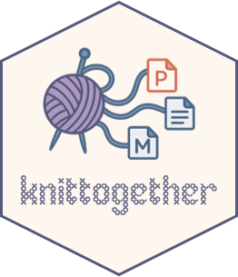
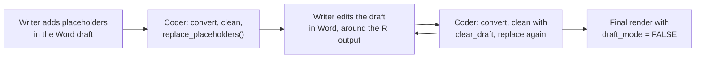

# knittogether 

## Overview

knittogether is an R package for reproducible collaboration between R users and non-R users. It helps teams produce high-quality Quarto outputs while reducing the friction of moving between Office and Quarto.

-   Import .docx / .pptx into markdown
-   Replace placeholders with R-generated content
-   Render back to Word, PowerPoint, HTML, etc.
-   Support round‑trip editing when working with non‑R colleagues iteratively

### Motivation

Working with non-R users often involves tedious manual steps such as copy-pasting text, reformatting images, adjusting slide breaks, redoing citations, and then starting again when someone changes something. Yet their contributions are often essential for creating meaningful reports and presentations. knittogether streamlines this process by allowing you to seamlessly combine content from Quarto, Microsoft Word, and Microsoft PowerPoint, including:

-   Text sections
-   Images and tables
-   Citations and footnotes
-   Slide breaks and sections

The result is a single, reproducible workflow that outputs to any Quarto-supported format (HTML, PDF, Word, PowerPoint, etc.), reducing errors and saving time for R users whilst allowing non-R users to contribute without technical barriers.

## Installation

```         
# install.packages("pak")
pak::pak("wyuill/knittogether")
```

As noted in the DESCRIPTION, if functions involving the import and/or export of citations are used then [Zotero](https://www.zotero.org/download) and [BetterBibTeX](https://github.com/retorquere/zotero-better-bibtex/releases) are required. To export live citations to .docx format, a [Lua filter](https://retorque.re/zotero-better-bibtex/exporting/zotero.lua) is required and must be specified in the YAML of the .qmd.

## Usage

knittogether lets a writer work in Word or PowerPoint while a coder fills in R output, and then rebuild the finished report from the code. Either person can start, and the loop repeats until the report is final.



### Terms

-   **Placeholder**: plain text in the Word file made of a common prefix and an ID, for example `knit_plot`. It marks where R output goes.
-   **Marker**: a styled span that keeps the placeholder name in the Markdown, so the placeholder can be found again on the next pass. Controlled by `marker_mode`.
-   **Draft block**: the R output wrapped between `DRAFT_CONTENT_START` and `DRAFT_CONTENT_END`. The writer can edit around it, and `clean_markdown(clear_draft = TRUE)` reduces it back to its placeholder.

### Quick start

1.  **Writer adds placeholders.** In the Word draft, type `knit_total` or `knit_plot` where R output should go, and write the commentary around them.

2.  **Coder fills them from R.** Convert the draft, clean it, define the content and replace the placeholders:

```r
library(knittogether)

convert_markdown("draft.docx", markdown_file = "draft.md")
clean_markdown("draft.md")

plot <- define_content(
  placeholder_id = "plot",
  output_mode = "chunk",
  content_type = "plot",
  content = { plot(1:10) },
  chunk_options = list(echo = FALSE)
)
total <- define_content(
  placeholder_id = "total",
  output_mode = "inline",
  content_type = "text",
  content = { nrow(mtcars) }
)

replace_placeholders(
  "draft.md",
  placeholder_prefix = "knit",
  code_content = placeholder_map(specs = list(plot, total)),
  draft_mode = TRUE
)
```

3.  **Writer edits the draft.** Render the Markdown to Word (for example with Quarto or Pandoc) and edit around the R output. Leave the draft markers in place.

4.  **Coder re-imports and refreshes.** Convert the edited Word file, clean it with `clear_draft = TRUE`, and run `replace_placeholders()` again. The R output is replaced, not duplicated.

5.  **Final render.** Run `replace_placeholders()` with `draft_mode = FALSE` and `marker_mode = "off"`, then render the Markdown with Quarto to any format. The output then has no placeholder names or markers. You can run this straight from the draft: any draft markers are removed. Keep the markers only while the document will still go back through Word.

Notes:

-   `marker_mode = "off"` writes no marker, so the inserted content can't be found again on re-import. Use it only for documents that won't go back through Word.
-   Quarto needs the Markdown to exist before it renders. The extended-workflow vignette shows a `pre-render` step that builds it automatically.
-   An example template with styled placeholders is included: `system.file("extdata", "PlaceholderMarker_example.docx", package = "knittogether")`.

## Working with versions

Every step can write to a new file instead of overwriting. Pass `output_file` to `clean_markdown()` or `replace_placeholders()`, and use `timestamped_path()` to give the output a time stamp so earlier versions are kept:

```r
replace_placeholders(
  "draft.md",
  code_content = placeholder_map(specs = list(plot, total)),
  output_file = timestamped_path("drafts/draft.md"),
  draft_mode = TRUE
)
```

Pass `overwrite = FALSE` to stop rather than write over an existing file. The default is `TRUE`, so existing scripts keep overwriting.

To use the newest Word file in a folder, pass the folder instead of a file name. `latest_word_file()` returns it, and `run_workflow()` accepts a folder directly, with an optional `base_name` to narrow the choice:

```r
run_workflow(
  input_file = "drafts",
  base_name = "report",
  markdown_file = "report.md",
  placeholder_prefix = "knit",
  code_content = placeholder_map(specs = list(plot, total)),
  draft_mode = TRUE
)
```

Each step reads the output of the step before it, so the cleaned file is the one that gets filled in.

## Getting help

-   Browse the function documentation (e.g. `?knittogether::clean_markdown`) and vignettes.

-   Please open an issue on GitHub or [get in touch](https://jsna.camden.gov.uk/about/#get-in-touch).

