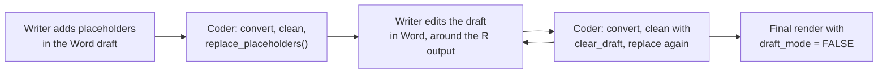

# knittogether 

knittogether lets you write a report with colleagues who work in Word or PowerPoint, while you keep the numbers, charts and tables in R. They keep writing in Office. You keep your analysis reproducible. Nobody copies and pastes.

## Why

Most reports need two kinds of work: someone who knows the subject writes the words, and someone else produces the analysis. A lot of time goes on the hand-over. Charts get pasted into Word and reformatted, slide breaks get fixed, citations get redone. Then the data changes, or someone rewrites a paragraph, and it all starts again.

With knittogether, the writer types a placeholder such as `placeholder_plot` where a chart should go. You convert the Word file to Markdown, fill each placeholder from R, and render the result with Quarto to Word, PowerPoint, HTML or PDF. The writer can keep editing in Word, and you can bring their changes back in without losing the R output. Text, images, tables, citations, footnotes and slide breaks all survive the trip.

## Installation

```r
# install.packages("pak")
pak::pak("wyuill/knittogether")
```

Reading PowerPoint files needs Pandoc 3.8.3 or later. Recent versions of RStudio, Positron and Quarto include one, and knittogether will find it. For citations you also need [Zotero](https://www.zotero.org/download) with the [Better BibTeX](https://retorque.re/zotero-better-bibtex/) add-on. `vignette("citations")` explains how to set this up.

## How it works



1. The writer types placeholders into the Word draft wherever R output should go.
2. You convert the draft to Markdown, tidy it up and fill in the placeholders.
3. The writer edits the draft in Word, writing around your output.
4. You bring their edits back in and refresh the R output. Steps 3 and 4 repeat as often as you need.
5. When the words are final, you render the finished report.

Either of you can start. You can also begin from a Quarto document and send it to Word for the first round of writing.

## Example

Say the writer's draft contains `placeholder_total` and `placeholder_plot`:

```r
library(knittogether)

convert_markdown("draft.docx", markdown_file = "draft.md")
clean_markdown("draft.md", placeholder_prefix = "placeholder_")

total <- define_content(
  placeholder_id = "total",
  output_mode = "inline",
  content = { nrow(mtcars) }
)
plot <- define_content(
  placeholder_id = "plot",
  output_mode = "chunk",
  content = { plot(mtcars$wt, mtcars$mpg) },
  chunk_options = list(echo = FALSE)
)

replace_placeholders(
  "draft.md",
  placeholder_prefix = "placeholder_",
  code_content = placeholder_map(specs = list(total, plot))
)
```

`draft.md` now has inline R code where `placeholder_total` was and an R chunk where `placeholder_plot` was. Include it in a Quarto document and render it to any format.

`vignette("knittogether")` goes through this step by step, including how to bring the writer's edits back in.

## Learn more

- [Getting started](https://wyuill.github.io/knittogether/articles/knittogether.html): the workflow step by step, including working back and forth with Word.
- [Extended workflow](https://wyuill.github.io/knittogether/articles/extended-workflow.html): a complete example you can copy and run.
- [Office styling and layout](https://wyuill.github.io/knittogether/articles/office-styling.html): setting up Word files so they convert cleanly.
- [Working with PowerPoint](https://wyuill.github.io/knittogether/articles/powerpoint.html): slide layouts, backgrounds, columns and slide breaks.
- [Using references](https://wyuill.github.io/knittogether/articles/citations.html): keeping Zotero citations working in both directions.

## Getting help

Every function has a help page, for example `?clean_markdown`. If something doesn't work, [open an issue](https://github.com/LBCamden/knittogether/issues) or [get in touch](https://jsna.camden.gov.uk/about/#get-in-touch).
